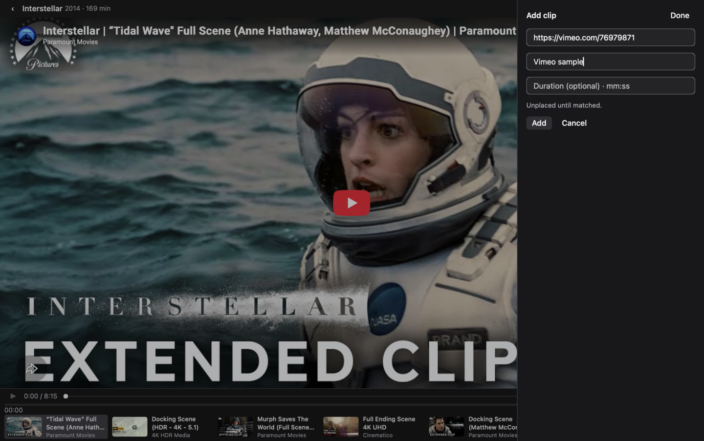
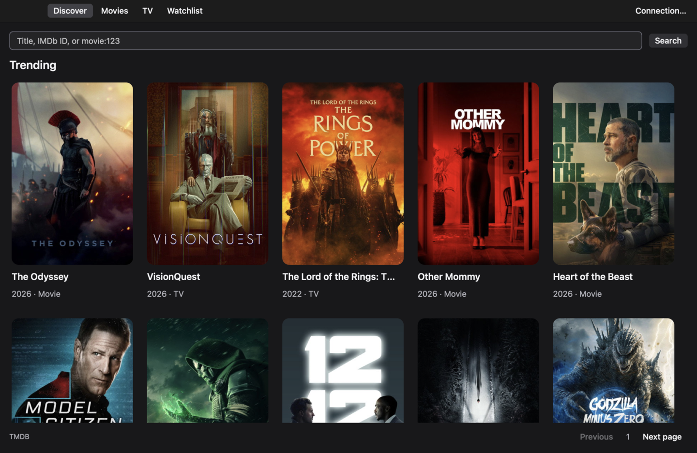
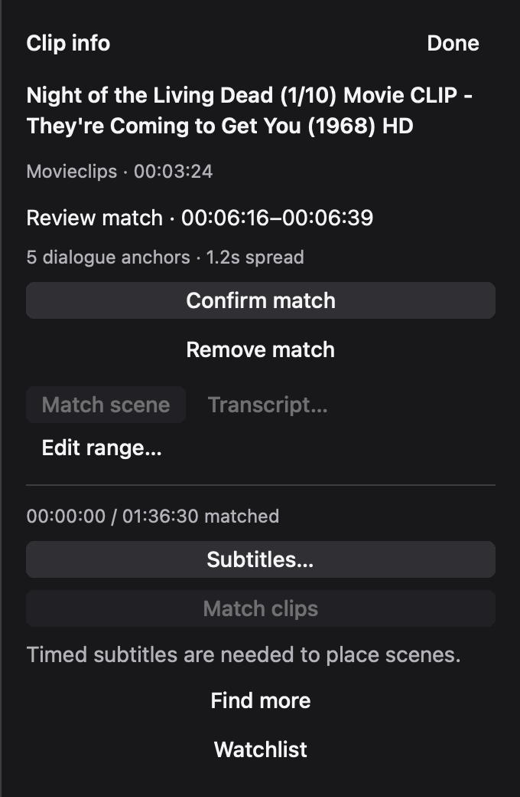

# ReelPopcorn — YouTube Movie Clip Player

**Watch movie and show clips together, free on YouTube.**

ReelPopcorn is a free, open-source desktop app for watching movie scenes and TV
episode clips from YouTube together. Find uploads, match their dialogue to timed
subtitles, and play confirmed scenes in chronological order on a movie timeline.
The compact, IINA-inspired theater keeps the picture front and center.

[](https://github.com/debpalash/ReelPopcorn/actions/workflows/ci.yml)
[](LICENSE)
[](#download)

Public alpha · macOS, with experimental Windows and Linux builds.
iOS and Android are planned, with no release date.

[Download](#download) · [Build from source](#run) · [How it works](#watch-in-order) ·
[Screenshots](#screenshots) · [FAQ](#faq) ·
[Releases](https://github.com/debpalash/ReelPopcorn/releases)


*Interface tour made from native Mac captures. This GIF is not a playback recording.*

## Screenshots



<details>
<summary>Browse titles and review clip timing</summary>





</details>

Screenshots show the native Mac app. Playback stays with the source provider;
proposed matches do not count as confirmed coverage.
[Capture details and media credits](docs/media/README.md).

## What it does

- **Find scenes.** Search YouTube uploads and playlists by title, release, opening,
  ending and dialogue in uncovered sections. No YouTube Data API key is needed.
- **Arrange the timeline.** Match captions against the same cut's timed subtitles,
  review proposed positions, trim overlaps and play confirmed ranges in order.
- **Browse movies and shows.** TMDB catalog, title/IMDb lookup, episode-specific
  runtimes and a local watchlist.
- **Focus on the picture.** Frameless window, native controls, dark/light appearance,
  a small clip dock and immersive mode.

ReelPopcorn plays the available scenes. It does **not** guarantee a complete movie:
missing uploads, unavailable captions, alternate cuts and silent scenes leave gaps.
Clip names, numbering and upload dates never stand in for verified movie times.

## Download

| Platform | Download |
| --- | --- |
| macOS 14+ · Apple Silicon | [Mac ZIP](https://github.com/debpalash/ReelPopcorn/releases/download/v0.1.1/ReelPopcorn-v0.1.1-macos-arm64.zip) |
| Windows 10 1809+ · x64 · experimental | [Windows ZIP](https://github.com/debpalash/ReelPopcorn/releases/download/v0.1.1/ReelPopcorn-v0.1.1-windows-x86_64.zip) |
| Linux · x86_64 · Ubuntu 24.04 or compatible · experimental | [Linux archive](https://github.com/debpalash/ReelPopcorn/releases/download/v0.1.1/ReelPopcorn-v0.1.1-linux-x86_64.tar.gz) |

Extract the whole archive. Windows needs WebView2; Linux needs GTK 4.14+ and
WebKitGTK 6.0. Install yt-dlp separately for local clip discovery. Downloaded
apps do not require Node.js or NSH. Mac builds are ad hoc signed and not
notarized; Windows builds are unsigned. See [installation and checksums](docs/INSTALL.md).

## Run

To build from source, install **Node.js 22.18+**,
[Native Shell 0.4.0](https://github.com/longbridge/nsh/releases/tag/v0.4.0),
your platform's runtime libraries and `yt-dlp` for local discovery.

Install NSH using its [official instructions](https://github.com/longbridge/nsh#quick-start)
with `NSH_VERSION=v0.4.0`. Then:

```sh
git clone https://github.com/debpalash/ReelPopcorn.git
cd ReelPopcorn
npm ci
npm run dev
```

Guest TMDB browsing works without a personal token through the public
[Nuxt Movies proxy](https://github.com/nuxt/movies). **Connection…** accepts your
own TMDB token and lets you choose yt-dlp or an Invidious instance. Public
providers can become unavailable; no application-owned backend is required.

## Watch in order

1. Open a movie, or choose a season and episode for a show. Scenes appear as
   discovery progresses; **Find more** searches additional queries and playlists.
2. Open **Info → Subtitles…**. Paste the exact cut's SRT/WebVTT, or use **Find
   timing source** to read captions from a matching full-length YouTube source.
   Check the cut, timecodes and runtime before saving.
3. Caption matching starts automatically. Review each proposed position and
   source range, then choose **Confirm match**. Use **Edit range…** for a scene
   whose position you have verified manually.
4. Choose **Play matched**. Confirmed clips play in movie order. The timeline
   shows coverage and missing sections; overlapping uploads count once.

**＋ / ⌘O** adds a source link. Imported YouTube, Vimeo, Twitch, TikTok and Spotify
links use Video.js adapters. Automatic discovery and caption matching are
YouTube-based. Provider playback has different limits; TikTok playback remains
experimental. Audio, collections and live streams cannot count toward a movie's
runtime. See [provider details](docs/DEVELOPMENT.md#other-providers).

| Shortcut | Action |
| --- | --- |
| ⌘F | Search titles |
| ⌘1 / 2 / 3 / 4 | Discover / Movies / TV / Watchlist |
| ⌘O | Add a source |
| Option + Right | Next clip |
| ⌘⇧F | Toggle immersive mode |
| Escape | Close editor, inspector or immersive mode |
| ⌘, | Connection settings |

Use Ctrl instead of ⌘ on Windows and Linux.

## FAQ

### Can I watch a whole movie from YouTube clips?

ReelPopcorn plays confirmed, available clips in movie order and shows the missing
sections. It cannot promise a full movie or a complete TV episode. Coverage depends
on uploads, captions and matching the same cut.

### How does chronological clip matching work?

Dialogue anchors align a clip's captions with a movie or episode's timed SRT/VTT
subtitles. You review the proposed source range and movie time before confirming.
Upload dates and clip numbers are not runtime evidence.

### Is it free and legal to use?

The app is free and open source. Choose official clips, licensed uploads or
public-domain material, and follow the source provider's terms. ReelPopcorn
cannot verify every uploader's rights. See [sources and rights](#sources-and-rights).

### Do I need a YouTube API key or a TMDB account?

No YouTube Data API key is required. Discovery uses yt-dlp or Invidious, and
guest TMDB browsing works without a personal token. You can connect your own
TMDB token if guest access is unavailable.

### Does it download videos or replace the YouTube player?

No. Video.js adapters use provider playback inside one retained WKWebView.
The catalog, timeline and compact controls are native. Ads, branding and playback
restrictions remain controlled by the provider.

## Sources and rights

Use official clips, licensed uploads or public-domain material. ReelPopcorn does
not verify an uploader's rights and does not make every YouTube upload lawful to
reuse. Free software is not a license to the underlying films, clips or subtitles.

Playback uses the provider's embedded player. Video files are not downloaded,
re-encoded or hosted by ReelPopcorn. Ads, branding, availability, embedding
restrictions and account requirements remain controlled by the provider.
yt-dlp/Invidious retrieve metadata and available captions; their availability
and permitted use depend on the service. Follow
[YouTube's terms](https://www.youtube.com/static?template=terms) and
[player requirements](https://developers.google.com/youtube/terms/required-minimum-functionality).
ReelPopcorn is independent of YouTube and TMDB.

## Build and contribute

```sh
npm run check       # typecheck, build, 48 tests, bridge/startup/process checks
npm run package     # native app, versioned archive and SHA-256 under dist/
```

GitHub Actions builds and tests all three desktop targets and keeps seven-day
CI artifacts. Pushing a matching version tag publishes a prerelease only after
every target passes. See [release development](docs/DEVELOPMENT.md#ci-and-packaging).

Built with [Native Shell](https://github.com/longbridge/nsh), TypeScript/TSX and
[Video.js HTML](https://videojs.org/). Browsing, timelines and controls are native;
one retained WKWebView supplies provider playback. Node is a development tool,
not a packaged-app requirement.

See [development](docs/DEVELOPMENT.md), [design](docs/DESIGN.md),
[validation](docs/VALIDATION.md), [changelog](CHANGELOG.md) and
[contributing](CONTRIBUTING.md). Bugs and ideas belong in
[Issues](https://github.com/debpalash/ReelPopcorn/issues).

Watchlists, subtitle references and annotations stay in app-local storage.
TMDB tokens are held for the session. There is no application analytics; metadata,
artwork and playback requests contact their respective providers.

## License and credits

[MIT](LICENSE) for original application code. Dependency licenses and media rights
are separate; see [credits](NOTICE.md) and
[third-party notices](THIRD_PARTY_NOTICES.txt).

Inspired by [Nuxt Movies](https://github.com/nuxt/movies),
[Reiverr](https://github.com/aleksilassila/reiverr) and
[SuggestArr](https://github.com/giuseppe99barchetta/SuggestArr).

This product uses the TMDB API but is not endorsed or certified by TMDB.
